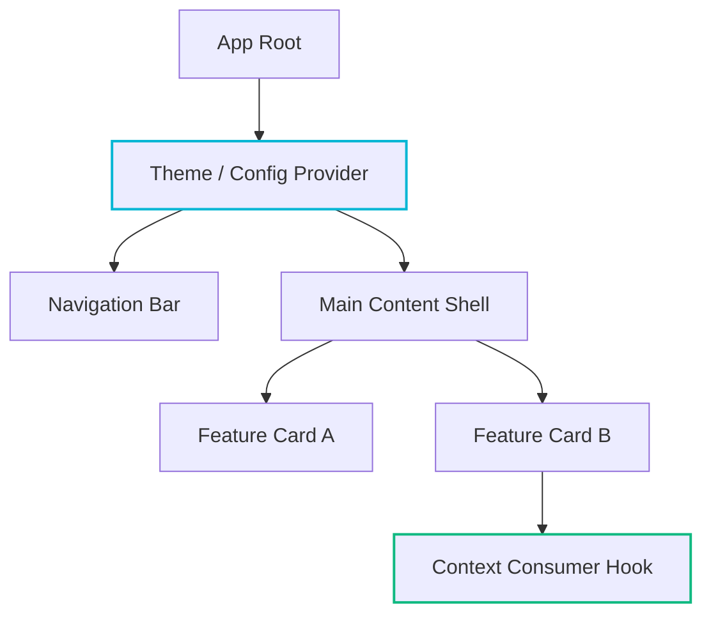

React Context is frequently misunderstood as a global state management mechanism. Context is fundamentally an ambient dependency injection primitive designed for low-frequency updates.

## The Context Propagation Model

When a Context Provider receives a new reference, all descendant components consuming that context are scheduled for re-rendering unless decoupled via intermediate selector boundaries.



## Architectural Decoupling

To prevent cascade re-renders across deep subtrees, split context into two distinct contracts: state and dispatcher.
`example`

```tsx
import { createContext, useContext, useReducer, type ReactNode } from "react";

type Theme = "light" | "dark" | "system";
type Action = { type: "SET_THEME"; payload: Theme };

const ThemeStateContext = createContext<Theme | undefined>(undefined);
const ThemeDispatchContext = createContext<React.Dispatch<Action> | undefined>(undefined);

function themeReducer(state: Theme, action: Action): Theme {
  switch (action.type) {
    case "SET_THEME":
      return action.payload;
    default:
      return state;
  }
}

export function ThemeProvider({ children }: { children: ReactNode }) {
  const [state, dispatch] = useReducer(themeReducer, "system");

  return (
    <ThemeStateContext.Provider value={state}>
      <ThemeDispatchContext.Provider value={dispatch}>
        {children}
      </ThemeDispatchContext.Provider>
    </ThemeStateContext.Provider>
  );
}

export function useThemeState(): Theme {
  const context = useContext(ThemeStateContext);
  if (context === undefined) {
    throw new Error("useThemeState must be used within a ThemeProvider");
  }
  return context;
}
```

<Callout type="tip" title="Dual Provider Split">
Splitting state and dispatch ensures that components only reading action dispatchers are never re-rendered when the state value evolves.
</Callout>

## Mathematical Convergence of Update Costs

Consider a tree of depth $d$ with branching factor $b$. Without selector boundaries, propagation cost satisfies:

$$
C_{\text{render}} = \sum_{k=1}^{d} b^k = \frac{b(b^d - 1)}{b - 1} \approx \mathcal{O}(b^d)
$$

With separate dispatch providers, components that only trigger actions incur cost:

$$
C_{\text{action}} = \mathcal{O}(1)
$$

## Summary

Use Context for ambient, stable environment data (auth sessions, theme configuration, localization) and delegate high-velocity transactional state to external synchronized stores.
