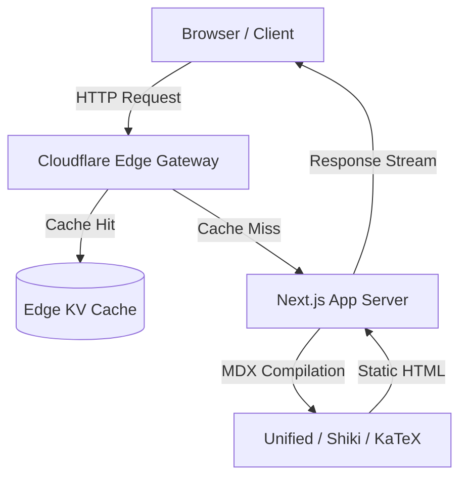

Welcome to the engineering notebook. This space documents architectural explorations, distributed system primitives, and interface mechanics built with deliberate constraints and high fidelity.

## Technical Foundation

Modern technical writing demands precise rendering across three critical modalities: syntax-highlighted code with semantic tokens, architectural graphs that illustrate data flow, and LaTeX notation for theoretical foundations.

### Syntax Highlighting with Shiki

Syntax highlighting in this workspace is powered by Shiki, running at build time using Dual Theme tokens. Code blocks do not flicker or incur client-side execution penalties.

```typescript
interface CacheConfig<T> {
  ttlMs: number;
  maxEntries: number;
  evictionPolicy: "lru" | "fifo" | "lfu";
  onEvict?: (key: string, value: T) => void;
}

export class BoundedMemoryCache<T> {
  private readonly store = new Map<string, { value: T; expiresAt: number }>();

  constructor(private readonly config: CacheConfig<T>) {}

  public get(key: string): T | undefined {
    const entry = this.store.get(key);
    if (!entry) return undefined;
    if (Date.now() > entry.expiresAt) {
      this.store.delete(key);
      this.config.onEvict?.(key, entry.value);
      return undefined;
    }
    return entry.value;
  }
}
```

<Callout type="note" title="Zero Runtime Highlighting">
  Code blocks are pre-compiled to static HTML spans during build time. The
  client only hydrates layout primitives, preserving sub-millisecond interaction
  responsiveness.
</Callout>

## System Flowcharts with Mermaid

Complex topologies and sequence flows benefit from declarative diagrams directly inside Markdown.



<Callout type="tip" title="Declarative Diagrams">
  Mermaid diagrams render with vector crispness and automatically adapt to your
  active light or dark color scheme.
</Callout>

## Mathematical Formulations

Theoretical models are expressed with KaTeX. Inline formulations like $O(n \log n)$ merge seamlessly into sentences, while block expressions articulate multi-variable equations:

$$
\mathcal{L}_{\text{seq}}(\theta) = -\sum_{t=1}^{T} \log P_\theta(y_t \mid y_{<t}, \mathbf{x}) + \lambda \|\theta\|_2^2
$$

When evaluating time complexities across distributed nodes:

$$
T_{\text{total}}(N) = \max_{i \in [1, N]} \left( T_{\text{compute}}(i) + T_{\text{network}}(i) \right) + \mathcal{O}(1)
$$

## Interactive Elements & Callouts

Custom components integrate directly into the prose without breaking typographical rhythm.

<Callout type="warning" title="Design Discipline">
  Notice that callouts avoid aggressive side stripes or saturated gradients.
  Tone is restrained, borders are subtle, and typography remains grounded in
  body proportions.
</Callout>

<Callout type="caution" title="State Persistence">
  Always ensure cache eviction keys are flushed prior to persistent storage
  rehydration.
</Callout>

## External and Internal Navigation

Cross-referencing documentation should feel natural. Check out our deep dive in the [Learn React Series](/blog/learn-react) to see how nested sub-series are structured, or review the [Next.js Documentation](https://nextjs.org) for underlying framework primitives.
